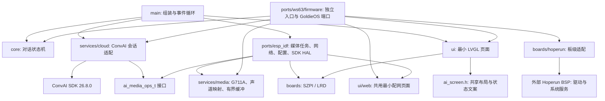

# Unified AI App

从立创实战派和利尔达 ESP32-S3 示例提取的最小 AI 语音对话应用。两块板使用同一套应用、云接入、媒体处理和界面，通过构建时选择板级适配。润和 WS63 已新增启动即进入 AI 页面的独立固件入口，共用业务层、音频处理、LVGL 页面源码和手机配网页面。原示例未修改。

固定使用 **ConvAI SDK 26.8.0**，随工程保留发布包、头文件及 ESP32-S3 / WS63 / Windows 静态库。来源与校验值见 [third_party/README.md](third_party/README.md)。

代码上库范围、排除项和逐文件用途见 [REPOSITORY_GUIDE.md](REPOSITORY_GUIDE.md)。

## 使用范围

- 润和 Windows 模拟器共用对话页面与业务代码，直接使用 Windows 网络，仅保留网络状态和 Start/Stop，不提供 Wi-Fi 配网。构建与运行见 [模拟器说明](ports/ws63/windows/README.md)。

- 屏幕仅显示板卡名称、网络/配网信息、会话状态，以及 **Start/Stop**、**Wi-Fi** 两个按钮。
- 立创板 BOOT 短按也可启停；利尔达板使用触摸按钮。
- 开始后连续采集，保留原有 8 kHz、双声道平面排列的 G711A 上行，以及云端打断事件处理。没有增加本地唤醒/AEC 算法。
- 断线后结束当前会话，网络恢复后由用户重新点击 Start。最小实现不自动重开对话。
- 三板字体使用 LVGL 内置英文字体，删除 Node.js、npm、Windows 字体文件和运行时生成字库的依赖。
- 移除音色选择、音量设置页、聊天记录、浮球、波形/动画、滑动手势、触摸诊断点、旧 LCD UI、面板工厂、功能调用控制和高频诊断日志。音量通过构建配置设置，Agent 的音色/角色使用云端配置。
- 三板共用热点 + 手机网页配网，保留扫描、连接并保存、删除/设默认网络和退出配网；不包含 OTA、应用商店或动态应用运行时。

## 分层



| 目录 | 边界与复用方式 |
|---|---|
| `core/` | 只依赖标准 C；同一个 owner 线程处理输入、网络和云事件，输出 `ai_view_t` |
| `services/cloud/` | 只依赖标准 C、SDK 公共头文件和媒体接口；不调用 LVGL、GPIO、FreeRTOS |
| `services/network/` | 无 OS 依赖的配网输入/HTTP/存储校验；平台分别负责网络和持久化 |
| `services/media/` | 无 OS 依赖的采样转换和缓冲；外部提供内存、锁与工作线程 |
| `ports/esp_idf/` | ESP-IDF 线程、同步、网络、时间、鉴权配置与 SDK HAL |
| `boards/` | 引脚、IO 扩展器、屏幕初始化、触摸和实际录放音；音频 Codec 驱动共用 |
| `ui/` | 仅消费状态快照、产生启停/配网命令；不依赖 ConvAI SDK |
| `main/` | 静态组装依赖并管理应用生命周期，不实现硬件驱动 |
| `ports/ws63/` | 公共静态库入口，以及 firmware 独立固件：组装、媒体/网络/配置、SDK HAL 和 LVGL 显示/触摸适配 |

参考 [ESP-Brookesia](https://github.com/espressif/esp-brookesia) 的硬件适配、服务、应用与表现层分离。当前功能规模使用静态依赖注入，不引入运行时服务注册、动态插件或多语言运行时。

## 板级差异

| 项目 | `szpi` 立创实战派 | `lrd` 利尔达 |
|---|---|---|
| Flash / PSRAM | 16 MB / Octal | 8 MB / Quad |
| IO 扩展器 | PCA9557，0x19 | TPT29555A，0x22 |
| 触摸 | FT6336，0x38 | CST836U，0x15 |
| ES7210 地址 | 0x41 | 0x40 |
| 上行麦克风 / 参考 | TDM slot0 / slot1 | TDM slot2 / slot1 |
| 按键 | GPIO0 BOOT | 无物理按键依赖 |

I2S 时序、Codec 初始化与 ST7789 寄存器序列来自对应原工程。不要仅修改板名切换硬件；Flash、PSRAM 与分区配置也必须一起切换。

## 构建与烧录

使用已激活的 ESP-IDF **6.1** 环境。组件清单允许 6.0–6.1，当前验证版本为 6.1.0。首次构建需要联网获取锁定版本的 LVGL、esp_codec_dev 和 cJSON。

在本目录执行，始终为两块板使用不同构建目录：

```sh
idf.py -B build-szpi -DUNIFIED_BOARD=szpi build
idf.py -B build-lrd -DUNIFIED_BOARD=lrd build
```

每个构建目录独立保存 sdkconfig。工程会拒绝在一个已配置的构建目录中切换板型。

配置云接入参数：

```sh
idf.py -B build-szpi -DUNIFIED_BOARD=szpi menuconfig
```

进入 `Unified AI application`，填写 Agent ID，以及 API key 或完整产品三元组。API key 非空时优先使用。WebSocket URL 留空使用 SDK 默认地址。利尔达板使用相同命令并替换目录和板型。

也可以在**首次配置之前**复制 `config/local.defaults.example` 为 `config/local.defaults` 并填写；此文件已被忽略。已有 sdkconfig 时，用 menuconfig 修改，defaults 不会覆盖已有值。

```sh
idf.py -B build-szpi -DUNIFIED_BOARD=szpi -p COMx flash monitor
idf.py -B build-lrd -DUNIFIED_BOARD=lrd -p COMx flash monitor
```

如需替换 SDK 存放路径，增加 `-DCONVAI_SDK_ROOT=/path/to/convai-sdk-26.8.0`，该目录必须同时提供 `include/convai` 和 `libs/esp32s3/libconvai_sdk.a`。缺库直接报错，不链接占位实现。

首次启动无已保存 Wi-Fi 时，屏幕显示 `AI-Setup-…` 热点名和配网页地址。连接开放热点后访问 `http://192.168.4.1`；扫描或输入 2.4 GHz 网络名称，连接并保存后点击“退出配网”。三板最多保存 10 个网络，列表首项为默认网络。联网并完成时间同步后点击 Start。点击 Wi-Fi 会先停止会话，再进入配网。TLS 使用自带证书包或 SDK 提供的 CA，保留服务器证书校验。

## WS63 独立应用

润和板启动后直接显示板名、会话状态、网络信息和 Start/Stop、Wi-Fi 按钮，不再进入“设置 → AI 设置”。公共层直接复用相同源码；UI 共用布局、配色、按钮文案和状态格式，三板均由同一份 `ui/ai_lvgl.c` 创建控件，字体、布局与交互一致，平台只负责显示刷新和触摸输入。

WS63 鉴权：复制 `config/ws63.local.h.example` 为 `config/ws63.local.h` 并填写。依赖、配置、构建及验收说明见 [WS63 README](ports/ws63/README.md)。最新 Hoperun 固件已烧写，用户确认显示、配网和对话正常。三款产品的平台/板级对比见 [BOARD_COMPARISON.md](BOARD_COMPARISON.md)。

## 生命周期与线程约束（以下硬件参数针对 ESP32）

- 所有核心状态变更在 `app_main` 的事件循环串行执行。SDK 回调只发送拷贝后的事件，不在回调中 stop/join。
- LVGL 只有 UI 任务操作。状态和网络文本经单元素快照队列传递；I2C 触摸读取在独立任务执行。
- 显示缓冲在 SPI DMA 完成回调后才归还 LVGL。删除旧实现“入队即 flush ready”的提前复用行为。
- 录音、播放任务启动一次。停止会话通过上行 barrier 等待发送结束，清空播放缓冲，再停止/销毁 SDK 引擎，不靠固定 sleep 猜测任务退出。
- 每次会话使用新的 session 代号，过滤已入队的旧回调。播放 reset 使用独立 epoch，防止已经取出的旧数据在 reset 后重新写入。
- G711A 下行缓冲默认 256 KiB，约 32 秒编码音频，使用 PSRAM；容量可配置。超过容量明确终止本次会话，避免静默截断或无限占用内存。
- 初始预缓冲 200 ms；短回复收到 finish 后立即排空；界面在缓冲及硬件尾部播完后返回 Listening。
- ESP 的播放队列锁不覆盖阻塞的 I2S 写入；独立输出锁协调播放与 reset，避免 SDK 音频入队等待播放时钟。该修改已烧写利尔达，用户本轮确认 Wi-Fi 和基础对话正常；长回复专项压力验证未单独记录。
- ESP Station 使用 PERFORMANCE 模式并为云端 TCP 设置 TCP_NODELAY，降低省电/小包合并延迟，但增加联网功耗。每 5 秒记录上行统计，连续失败时记录真实 SDK 返回码。
- 软件 reset 后硬件 DMA 仍可能有最多约 180 ms 尾音，这是保留的 I2S DMA 配置预算，尚需实板测量。不是硬件级即时静音保证。
- SDK 26.8.0 音频回调只提供格式，未暴露响应 ID。当前依赖 SDK 有序交付状态/音频事件；不能识别跨越新一轮 ANSWERING 才到达的旧音频包。

## 测试

本次执行结果及固件产物见 [VALIDATION.md](VALIDATION.md)。

主机测试不依赖 ESP-IDF，也不连接云服务。需要 CMake 和本机 C11 编译器：

```sh
cmake -S tests -B build-host
cmake --build build-host
ctest --test-dir build-host --output-on-failure
python tools/check_architecture.py
```

Windows 使用 MinGW 时，可以在其环境中添加 `-G Ninja -DCMAKE_C_COMPILER=gcc`。测试覆盖会话关闭/重启、迟到事件、网络断开、连接超时与时间回绕、100 次启停、G711 向量、两种声道映射、缓冲回绕/溢出/短音频、SDK 创建失败与启动失败，以及回调中的打断和断线处理。

可选的 WS63 公共库交叉编译检查（不属于 Hoperun 固件/模拟器构建流程；旧构建目录已清理）：

```sh
cmake -S ports/ws63 -B build-ws63-core -G Ninja -DCMAKE_TOOLCHAIN_FILE=../ai-hardware-agent-examples/cmake/toolchains/ws63-riscv-gcc.cmake
cmake --build build-ws63-core
```

此入口只生成公共静态库；独立固件使用 `ports/ws63/firmware` 入口，说明见 [ports/ws63/README.md](ports/ws63/README.md)。

## 实板验收

利尔达已由用户确认 Wi-Fi 和基础对话正常；润和此前已确认基础对话和 DHCP 网关修复后的自动门户弹窗正常。清理与 Hoperun 板级分层后的镜像已烧写，用户确认显示、配网、对话回归正常。实战派最新镜像也已烧写，用户确认显示、配网和对话正常。详细记录见 VALIDATION.md。

默认没有恢复旧工程的看门狗关闭配置。若实板触发看门狗，应根据回溯定位阻塞或高优先级忙循环，避免通过关闭看门狗掩盖问题。

### 三板共用的配网门户协议

`services/network/ai_portal.c` 是无 RTOS、socket 或厂商头文件依赖的 DNS 应答模块。润和 WS63、利尔达和实战派 ESP32-S3 共用该实现：IN/A 返回热点 IPv4，TTL 为 28 秒；AAAA 等其他 IN 查询返回空成功应答；异常报文不响应，附加记录不回显。HTTP 应用路由处理后，其他 GET 均以 302 跳回配网页面，并设置 no-store。ESP 保留原语言参数。

共享层还包括 `ai_provision.c` 的参数校验和 `ui/web` 的页面及交互。热点启停、DHCP/DNS 地址下发、线程与 socket 生命周期、HTTP 框架、Wi-Fi 扫描连接和 NV/NVS 存储留在平台适配层。协议统一不等于手机自动弹窗已验证，仍需硬件回归。

WS63 自动门户适配：润和预编译 DHCP 服务的实际应答缺少默认网关。`ports/ws63/firmware/portal_gateway.c` 配合 `dhcp_gateway.c` 对缺少 Option 3 的 Offer/ACK 补入 AP 地址，并更新 UDP 校验和；ESP 不需要此适配。2026-10-10 用户确认自动弹窗修复，日志同时确认网关、HTTP 探测、302 与页面加载。提交前已删除临时 DHCP 观察器及逐请求日志，网关补全逻辑保留。


### 2026-10-10 Hoperun 板级拆分

当前已增加 boards/hoperun，与 boards/lrd、boards/szpi 并列。电源/引脚、外设获取、屏幕传输、音频通道布局及 BSP 默认路径进入板级；ports/ws63 保留平台运行时、网络、TLS/SDK、存储和应用接入。使用 WS63_BOARD 选择实现，新增兼容 BSP 板主要修改 boards。接口兼容边界见 boards/hoperun/README.md；尚未验证任意厂商 RTOS/BSP。
